<p align="center"></p>

<p align="center"><b>When the grid goes down, Aftergrid boots up.</b><br>
A complete offline survival and medical library, maps and a local AI on one USB stick. Plug it into any PC, boot, and it works with no internet.</p>

---

## What's on the stick

| | |
|---|---|
| **Field Mode** | One home screen for everything: Medical, Water, Food, Shelter, Repair, Power, Maps, Comms, Ask, Go-Bag. Works on the PC, and on any phone on the same Wi-Fi. |
| **Offline library** | 10 libraries and 7 field manuals: WikiMed medical encyclopedia, US Army First Aid (FM 4-25.11), Special Forces Medical Handbook (ST 31-91B), Emergency War Surgery, Appropedia, Greek Wikipedia and more. One search box covers all of them. |
| **First-aid cards** | 30 short cards for emergencies (bleeding, CPR, choking, burns, stroke, hypothermia, snake bite, childbirth…) with 14 drawn diagrams. Each card lists its sources. |
| **Ask Aftergrid** | A local AI (Qwen3, runs on the CPU, no internet) that answers from the library only, cites its sources, shows the relevant diagrams, and flags any number that isn't in the sources. |
| **Source links** | Every citation opens the original page with the exact passage highlighted. |
| **Offline maps** | Street-level vector maps that work offline, with "where am I". |
| **Comms** | Emergency and calling frequencies (marine, aviation, CB, PMR446, FRS/GMRS, ham, NOAA) and what you may legally do with each. |
| **Go-Bag card** | A printable emergency card for each family member, saved only on the encrypted stick. |
| **Encrypted saves** | Your files, notes and settings stay on the stick, encrypted (LUKS2). Lose the stick, nobody reads it. |
| **Six languages** | English, Ελληνικά, Français, Deutsch, Português, Türkçe: OS, portal and search. |
| **Day / Night** | Light by default, Night mode for the dark, and a low-power mode to save battery. |
| **Claude built in** | Claude desktop and Claude Code are preinstalled for when there *is* a connection. |
| **Setup wizard** | First boot walks you through language, encrypted saves, your own account, Wi-Fi (optional) and extra downloads. |
| **USB Maker for Windows** | One small program writes the stick and checks every byte afterwards. |

## Screenshots

### Field Mode
| Day | Night | Ελληνικά |
|---|---|---|
| 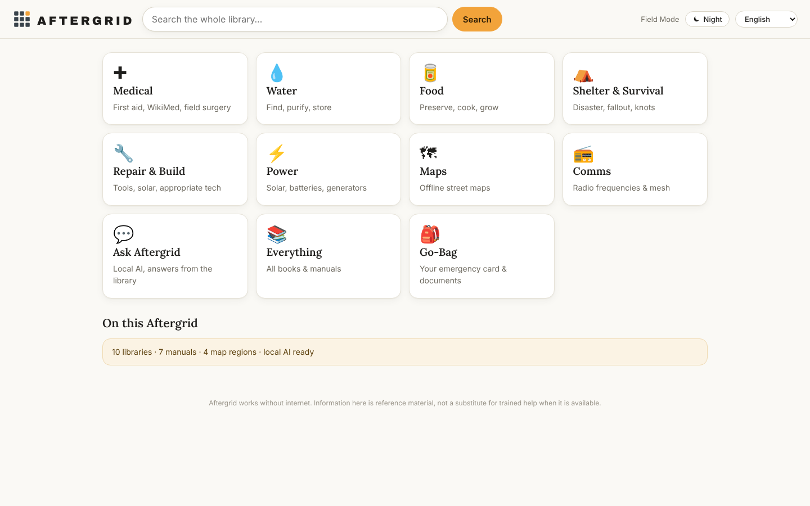 |  | 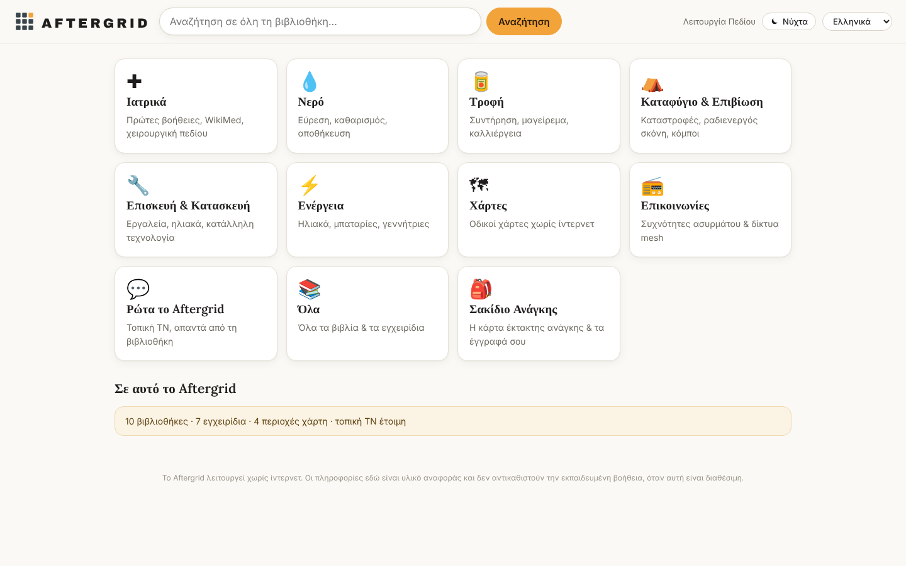 |

### Medical and first aid
| Medical shelf | First-aid card | Diagrams |
|---|---|---|
| 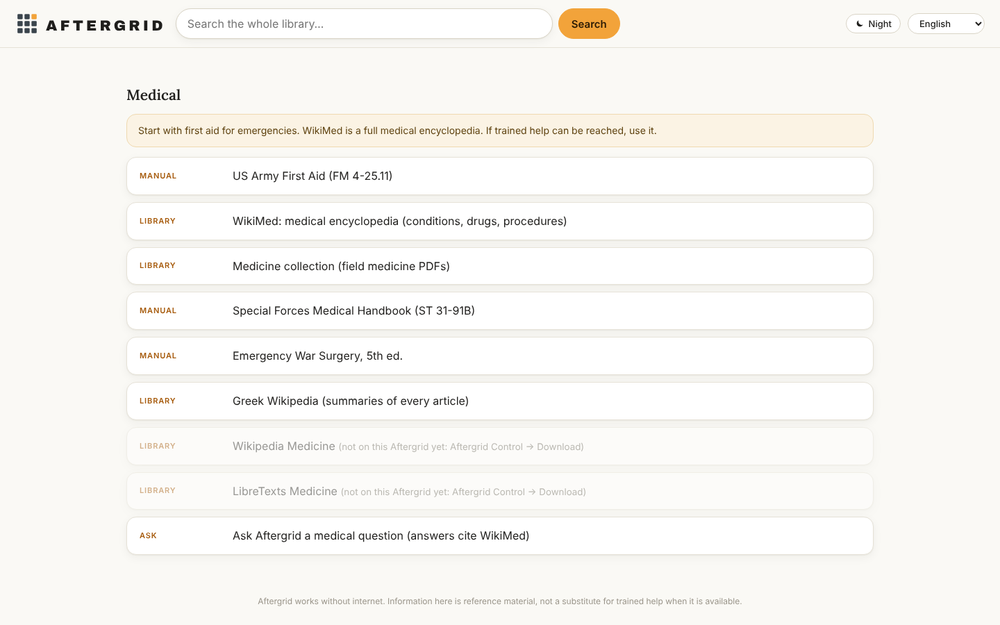 | 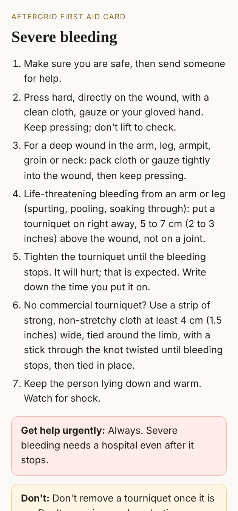 |  |

### Ask Aftergrid (offline AI)
| Ask | Answer with sources and diagrams | Source, passage highlighted |
|---|---|---|
| 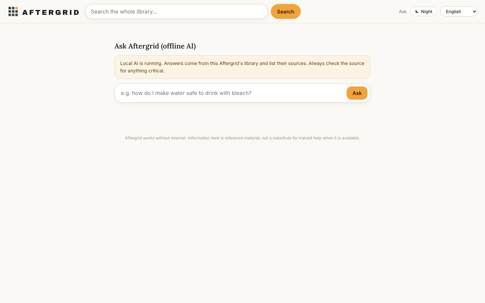 | 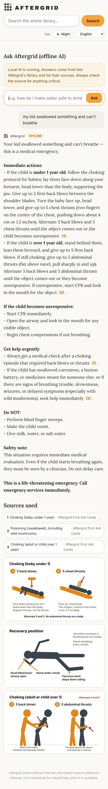 | 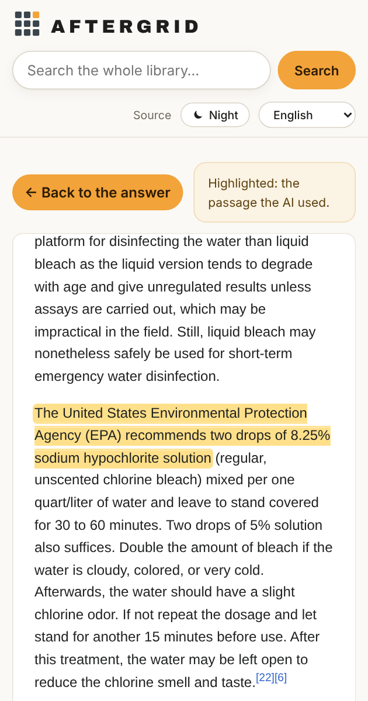 |

### Search, maps, comms, go-bag
| Search the whole library | Offline maps |
|---|---|
|  | 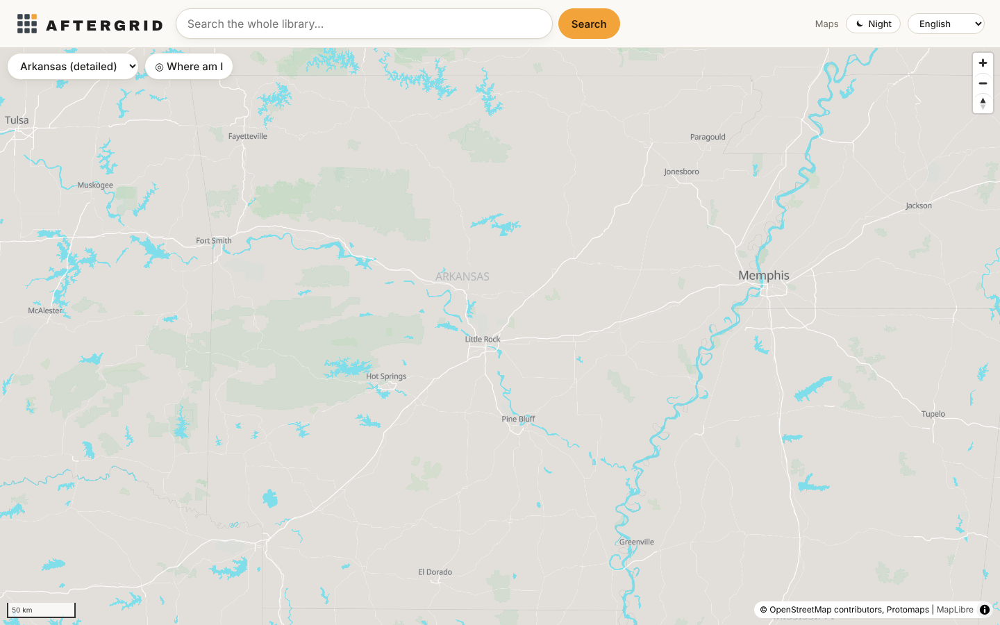 |

| Radio frequencies | Emergency card |
|---|---|
|  |  |

### On a phone
| Home | Search |
|---|---|
| 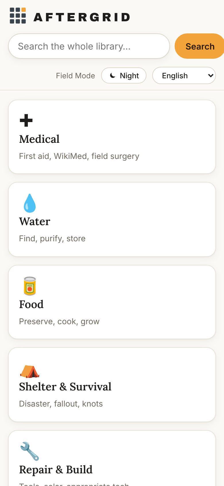 | 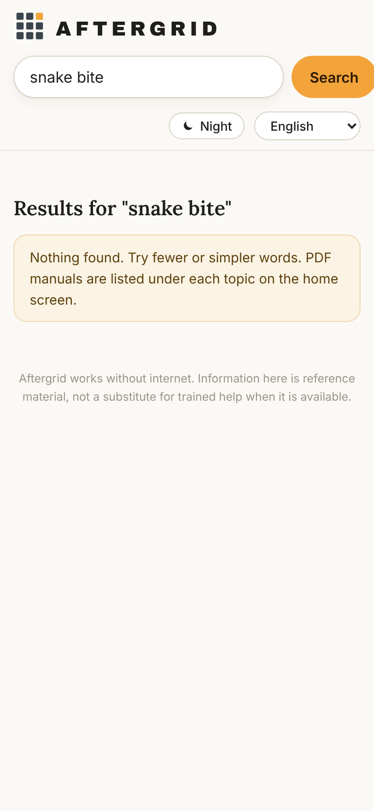 |

### Booting and setup
| Boot menu | Desktop + setup wizard | Wizard |
|---|---|---|
| 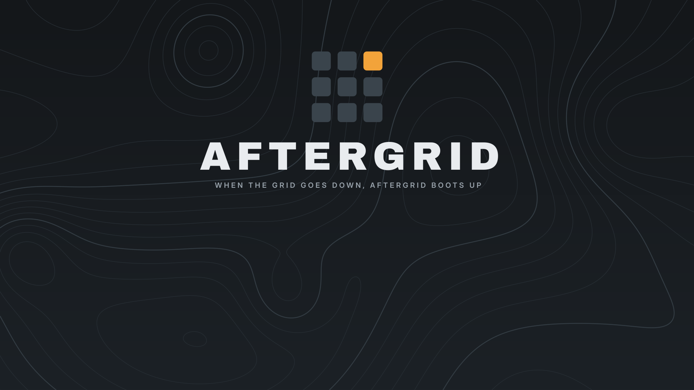 | 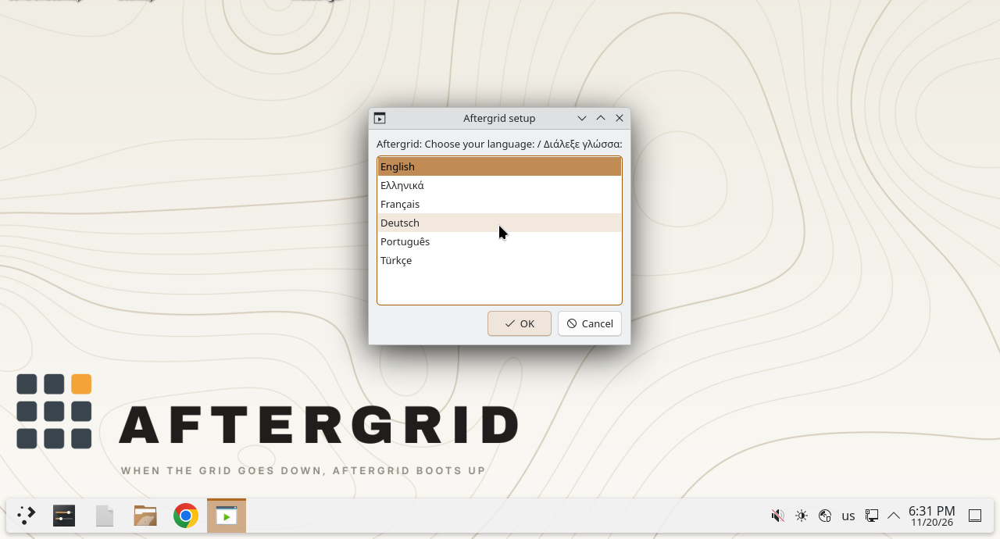 | 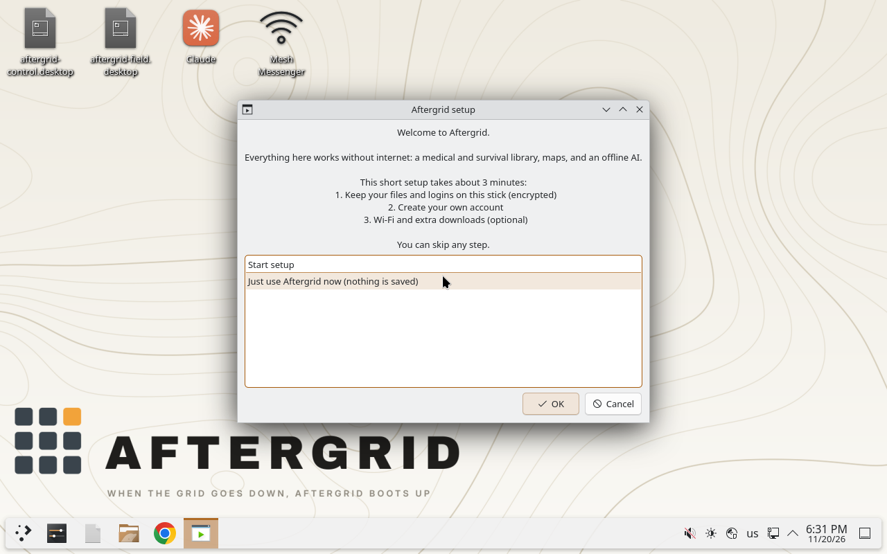 |

### Making the stick on Windows


## Build it

Needs Debian/Ubuntu, root, ~20 GB free disk.

```
./fetch-content.sh            # libraries, models, maps, packages (~9 GB, not in git)
sudo ./build-aftergrid.sh full   # or: core | standard
```

Output: `out/parts/` (the image in 380 MB parts + `aftergrid-image.json` + `Aftergrid USB Maker.exe`). Put the parts next to the USB Maker on Windows and run it, or on Linux/Mac: `cat Aftergrid-*.part | sudo dd of=/dev/sdX bs=4M`.

See `BUILD.md` for details and `CLAUDE.md` for the code map.

## Medical disclaimer

Aftergrid is reference material, not a substitute for trained help. First-aid cards are under clinical review; see the review checklist before relying on them.
