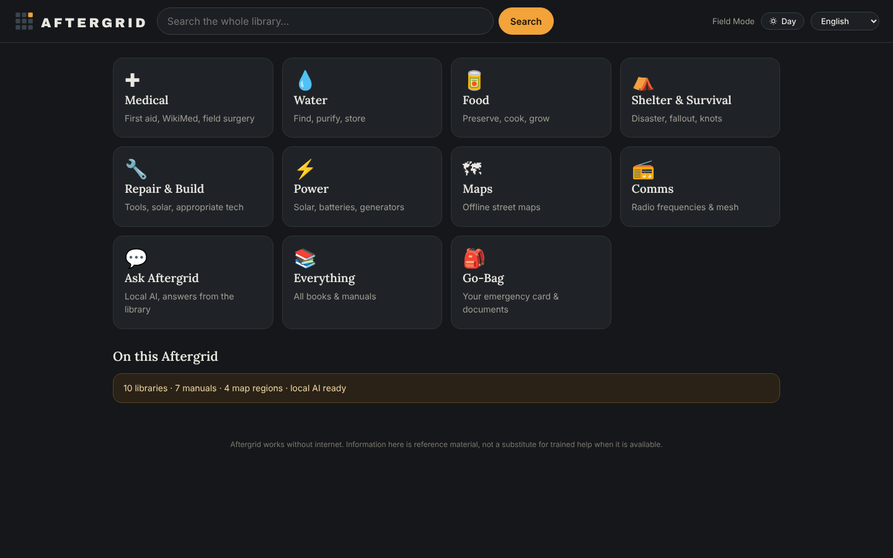
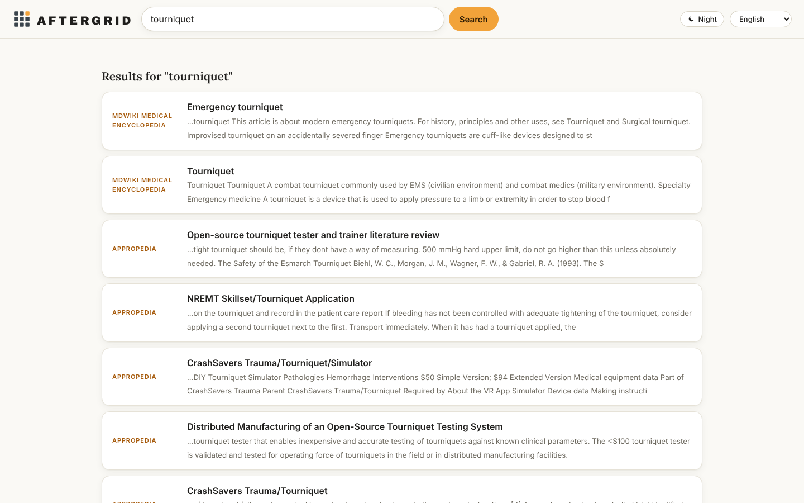
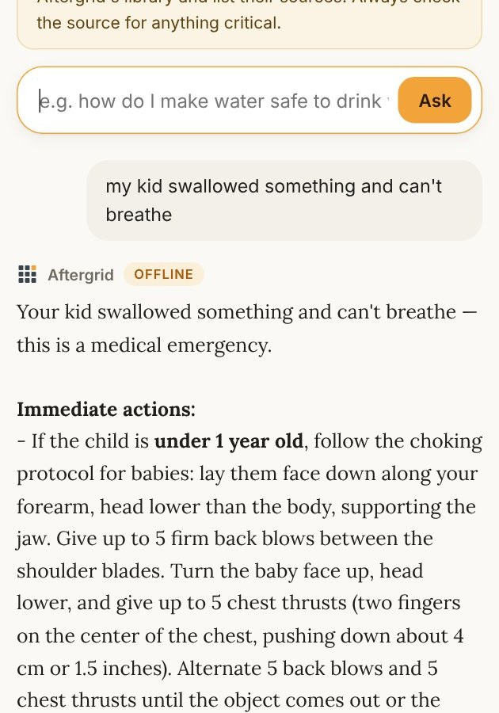
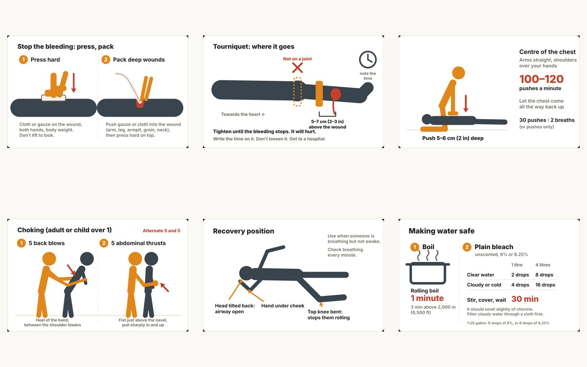
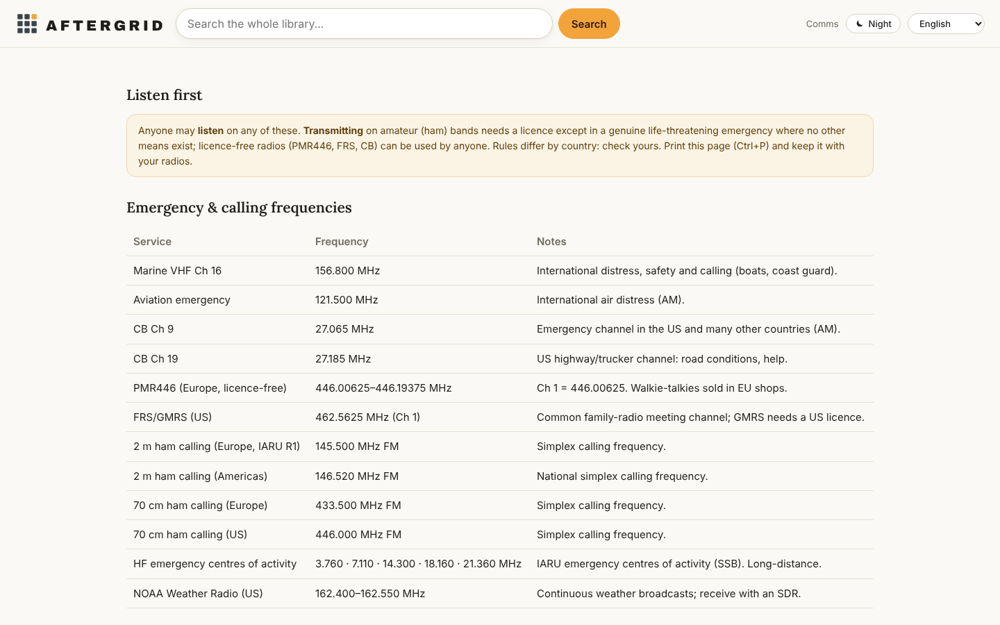
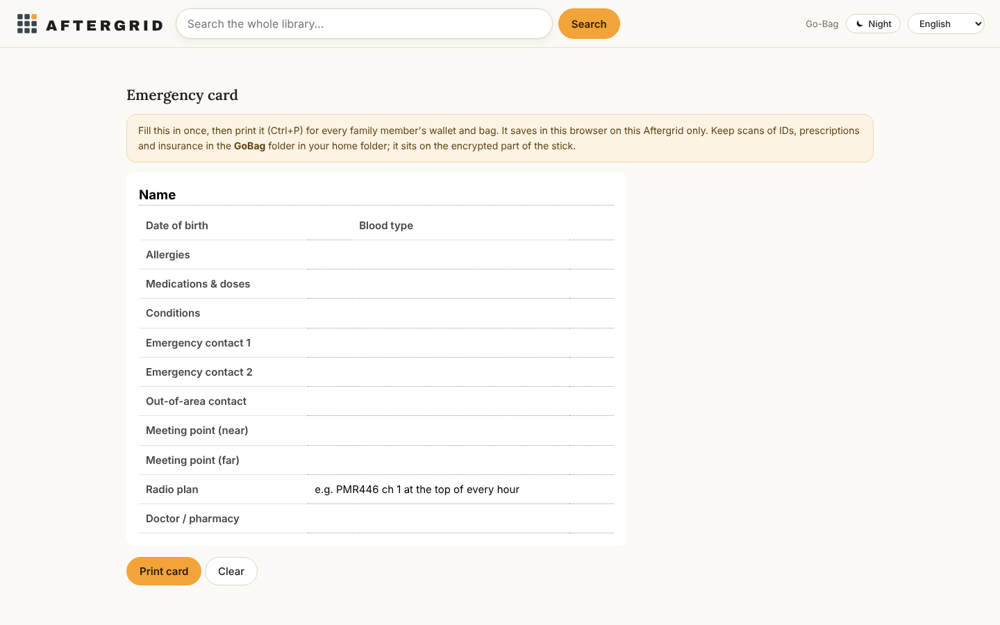
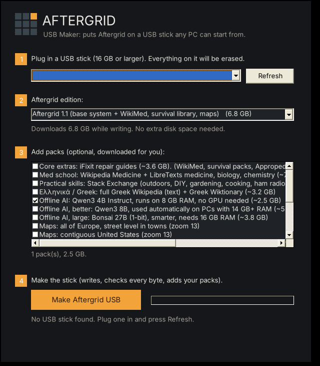

<p align="center"></p>

<p align="center"><b>When the grid goes down, Aftergrid boots up.</b><br>
An offline survival and medical library, maps and an on-device AI on one USB stick.<br>Plug it into any PC, boot, and it works with no internet.</p>

<p align="center">
<a href="#whats-on-the-stick">Features</a> ·
<a href="#screenshots">Screenshots</a> ·
<a href="#build-it">Build</a> ·
<a href="#repository-layout">Repo layout</a> ·
<a href="landing/">Landing page</a>
</p>

<p align="center"></p>

---

## What's on the stick

| | |
|---|---|
| **Field Mode** | One home screen: Medical, Water, Food, Shelter, Repair, Power, Maps, Comms, Ask, Go-Bag. Also opens on any phone on the same Wi-Fi. |
| **Wikipedia, backed up** | WikiMed (Wikipedia's medical encyclopedia, with images) and Greek Wikipedia are on the stick. All of English Wikipedia is a one-click add-on in setup: 12 GB (every article's summary and key facts) or ~110 GB complete with images. |
| **Field manuals** | US Army FM 4-25.11 First Aid, ST 31-91B Special Forces Medical Handbook, Emergency War Surgery, Nuclear War Survival Skills, FM 21-76 Survival, ATP 3-50.21, FM 21-10 Field Hygiene. |
| **Survival libraries** | Appropedia, post-disaster, water, food preparation, knots and medicine collections. One search box covers everything. |
| **First-aid cards** | 30 short cards with 14 drawn diagrams. Each lists the guideline it's based on. |
| **Ask Aftergrid** | On-device AI (Qwen3, runs on the CPU) that answers from the library only, cites numbered sources, shows the matching diagrams and flags any number it can't find in the sources. |
| **Source links** | Every citation opens the original page with the passage highlighted. |
| **Offline maps** | World overview, Greece, Crete and Arkansas built in. All of Europe or the USA at street level from setup. |
| **Comms** | Emergency and calling frequencies (marine, aviation, CB, PMR446, FRS/GMRS, ham, NOAA) and what's legal to transmit. |
| **Go-Bag card** | Printable emergency card per family member, saved only on the encrypted stick. |
| **Encrypted saves** | Files, notes and settings persist on the stick, encrypted with LUKS2. |
| **Six languages** | English, Ελληνικά, Français, Deutsch, Português, Türkçe. |
| **Day / Night** | Light by default, Night mode, low-power mode. |
| **Claude built in** | Claude desktop and Claude Code preinstalled for when there is a connection. |
| **Setup wizard** | First boot: language, encrypted saves, your account, optional Wi-Fi, extra downloads. |
| **USB Maker** | Windows app that writes the stick and verifies every byte. |

## Screenshots

### Field Mode

<table>
<tr>
<td width="33%"></td>
<td width="33%"></td>
<td width="33%"></td>
</tr>
<tr><td align="center">Day</td><td align="center">Night</td><td align="center">Ελληνικά</td></tr>
</table>

### Ask Aftergrid: the on-device AI

<table>
<tr>
<td width="33%"></td>
<td width="33%"></td>
<td width="33%"></td>
</tr>
<tr><td align="center">Ask a question</td><td align="center">Search the whole library</td><td align="center">Medical shelf</td></tr>
</table>

<table>
<tr>
<td width="33%"></td>
<td width="33%"></td>
<td width="33%"></td>
</tr>
<tr><td align="center">A real answer, with sources</td><td align="center">Source, passage highlighted</td><td align="center">First-aid card</td></tr>
</table>

### First-aid diagrams

<p align="center"></p>

### Maps, comms, go-bag

<table>
<tr>
<td width="33%"></td>
<td width="33%"></td>
<td width="33%"></td>
</tr>
<tr><td align="center">Offline maps</td><td align="center">Radio frequencies</td><td align="center">Go-Bag emergency card</td></tr>
</table>

### On a phone

<table>
<tr>
<td width="25%"></td>
<td width="25%"></td>
<td width="50%">Any phone on the same Wi-Fi opens the full library in its browser. No app to install.</td>
</tr>
</table>

### Boot, setup and the USB Maker

<table>
<tr>
<td width="33%"></td>
<td width="33%"></td>
<td width="33%"></td>
</tr>
<tr><td align="center">Boot menu</td><td align="center">First boot: setup wizard</td><td align="center">USB Maker for Windows</td></tr>
</table>

## Build it

Needs Debian or Ubuntu, root, ~20 GB free.

```bash
./fetch-content.sh                 # libraries, models, maps, packages (~9 GB, not in git)
sudo ./build-aftergrid.sh full     # or: standard | lite
```

Output goes to `out/parts/`: the image in 380 MB parts, `aftergrid-image.json` and `Aftergrid USB Maker.exe`.

**Write the stick:**
- **Windows:** put the parts next to `Aftergrid USB Maker.exe` and run it.
- **Linux / Mac:** `cat Aftergrid-*.part | sudo dd of=/dev/sdX bs=4M status=progress`

Full details in [`BUILD.md`](BUILD.md).

## Repository layout

```
build-aftergrid.sh        Build the ISO (live-build) and split it into parts
fetch-content.sh          Download libraries, AI models, maps and packages
build/config/             live-build config: package lists, hooks, boot menu
  includes.chroot/        Everything installed into the OS
    usr/share/aftergrid/portal/   Field Mode web app (search, Ask, maps, comms, go-bag)
    usr/local/bin/                Setup wizard, AI launcher, semantic search, control menu
    etc/systemd/system/           Library, AI, embedding and search services
content/
  cards/                  First-aid cards and SVG diagrams (source)
  tools/                  Builds cards and manuals into searchable ZIM files
  ai/                     Semantic search index metadata
flasher/usbmaker/         Aftergrid USB Maker for Windows (C#)
i18n/                     Translations (6 languages) and generator
eval/                     Retrieval and answer-quality tests for the AI
landing/                  getaftergrid.com landing page (static, Vercel-ready)
marketing/                Social video and image generators
branding/                 Logo, wallpaper and boot-screen generator
web/                      Map style and font tooling
docs/                     Screenshots and logo used in this README
```

Code map for Claude Code: [`CLAUDE.md`](CLAUDE.md).

## Medical disclaimer

Aftergrid is reference material, not a substitute for trained help. The first-aid cards are under clinical review.
